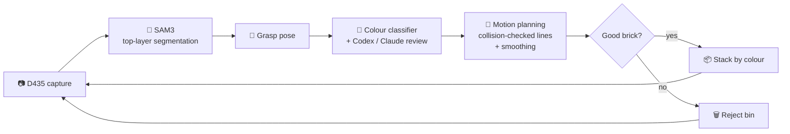
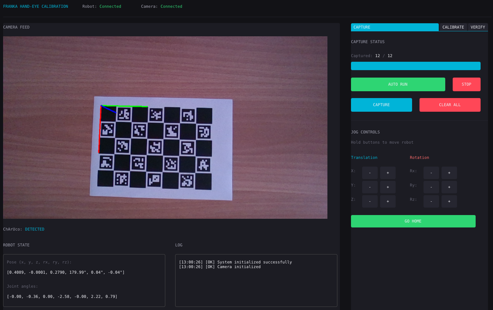
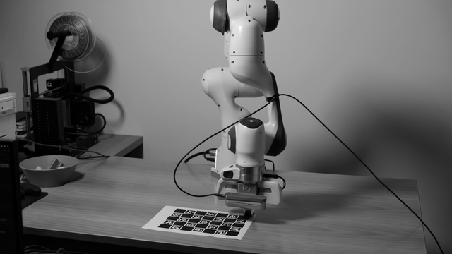

<div align="center">

# 🧱 Vision Guided Robot Palletizer

### A Franka FR3 that *sees* a pile of bricks, *judges* each one, and *stacks* the good ones by colour.


*Built at the **Marmon × Franka hackathon** by **Team 8A***

[Overview](#-what-it-does) · [Pipeline](#-how-it-works) · [Quick start](#-quick-start) · [Simulation](#-factory-line-simulation) · [Repo map](#-repository-map) · [Team](#-team-8a)

</div>

---

## ✨ What it does

A **Franka FR3** arm with a **wrist-mounted RealSense D435** looks at a pile of bricks and:

1. 👁️ **Finds** the top layer of the pile
2. 🎨 **Judges** each brick's shade: *good* or *bad*
3. 🤏 **Picks** the bricks one by one
4. 📦 **Stacks** the good ones by colour, and drops the bad ones in a bin

The same idea is simulated for a **whole brick factory line** in NVIDIA Isaac Sim.

### 🎯 Three deliverables

| | Deliverable | Where |
|:-:|---|---|
| 🔬 | **Real-brick classification**: good or scrap, on real sample bricks | [`classification/real_bricks/`](classification/real_bricks) |
| 🤖 | **Live robot demo**: LEGO bricks stand in for fired bricks | [`robot/`](robot) · [`perception/`](perception) · [`calibration/`](calibration) · [`franka/`](franka) |
| 🏭 | **Full-line factory simulation**: kiln cart to pallet | [`simulation/`](simulation) |

---

## 🧭 How it works



The sorter loops **scan → pick → recover → repeat** until the whole pile is empty.

### 📈 Smooth, precise motion

On the real robot, trajectory smoothing cut the **peak jerk of real moves from 49–461 down to 0.3–2.0 rad/s³**, with the hand held within **0.01 mm** of the straight line.

---

## 🚀 Quick start

> [!WARNING]
> **The robot moves on its own.** Keep the e-stop in reach. Only one robot stack may run in a ROS domain.

### 1 · Build

```bash
cd ~/vision-guided-robot-palletizer
./build.sh          # once (compiles libfranka, so the first build takes a while)
source env.sh       # in EVERY terminal: ROS 2 Humble, this workspace, ROS_DOMAIN_ID=77
```

### 2 · Run

```bash
# terminal 1: the robot, MoveIt and RViz
ros2 launch fr3_pose_pick pose_bringup.launch.py robot_ip:=192.168.3.10

# terminal 2: the sorter
ros2 run fr3_pose_pick sort_pile.py --config robot/fr3_pose_pick/config/pose_pick.yaml
```

<details>
<summary><b>⚙️ Setup details (click to expand)</b></summary>

- **Reuse an existing Franka workspace:** `export FRANKA_WS=<its folder>` before `./build.sh` and `source env.sh`.
- **Re-record poses** (`observe`, `bin`, `stack_<colour>`, `pile_corner_1/2`) with `record_pose.py` whenever the table layout changes. See [`robot/fr3_pose_pick/README.md`](robot/fr3_pose_pick/README.md) and [`docs/sorter_documentation.md`](docs/sorter_documentation.md).
- **Camera step requirements:** a Python environment with SAM3 (conda env `sam3`, a CUDA GPU, Hugging Face access to `facebook/sam3`). For the review step, the Codex CLI must be logged in (`--review claude` or `--review none` are the alternatives). See [`perception/requirements.txt`](perception/requirements.txt).

</details>

### 3 · Test (no robot needed)

```bash
source env.sh
PYTEST_DISABLE_PLUGIN_AUTOLOAD=1 python3 -m pytest -q robot/fr3_pose_pick/test
```

---

## 🎥 Hand-eye calibration

The camera-to-hand transform is solved with a ChArUco board using the app in [`calibration/handeye_tool/`](calibration/handeye_tool).

<div align="center">


</div>

The result lives in [`calibration/results/charuco_result.json`](calibration/results/charuco_result.json).

---

## 🏭 Factory line simulation

The ACME line in Isaac Sim covers dehacking, reject robots, separator, gantries and pallets, with its own validation and collision audit.

```bash
~/env_isaacsim/bin/python simulation/factory_line/run_factory.py --camera Separator --start 105
```

- Needs Isaac Sim (pip environment).
- Measured numbers and limits are in [`simulation/factory_line/README.md`](simulation/factory_line/README.md).
- Generated output (`output/`) is not kept in the folder. Rebuild it with `build_factory.py`.

---

## 🗂️ Repository map

| Folder | What is in it |
|---|---|
| 🤖 [`robot/fr3_pose_pick/`](robot/fr3_pose_pick) | The ROS 2 package: **motion planning** (collision-checked straight lines, trajectory smoothing), pick and place, the pile sorter `sort_pile.py`, palletizing, recorded poses, all settings (`config/pose_pick.yaml`) and the unit tests |
| 🦾 [`franka/`](franka) | Franka's own software, as used on the robot: `franka_ros2` (drivers, MoveIt config, hand), `libfranka`, `franka_description` |
| 🎯 [`calibration/`](calibration) | **Hand-eye calibration**: `results/` (camera-to-hand result and samples) and `handeye_tool/` (the app that captures samples and solves it) |
| 👁️ [`perception/`](perception) | Camera and vision: D435 capture, SAM3 top-layer segmentation, grasp pose, colour classifier, Codex or Claude review, colour-model setups. Run `run_pipeline_classifier.sh` here |
| 🔬 [`classification/real_bricks/`](classification/real_bricks) | Classifier for real (fired) bricks: SAM3 plus the frozen "Approach 17" model |
| 🏭 [`simulation/factory_line/`](simulation/factory_line) | Isaac Sim ACME line: dehacking, reject robots, separator, gantries, pallets, with validation and collision audit |
| 🧪 [`simulation/brick_scenes/`](simulation/brick_scenes) | Isaac Sim brick scenes (RGB-D like a real D435) and colour-model training from them |
| 📚 [`docs/`](docs) | `sorter_documentation.md`: the full technical description of the sorter |

---

## 👥 Team 8A

This was a team project. Roles are as the team listed them, and the code listed under a name is what that person's commits wrote.

| Who | Role | Code |
|---|---|---|
| **Ameed Nazhurudeen** | Robotics and motion planning | `robot/`: straight-line motion planning with collision and joint-swing checks, trajectory smoothing, grasp and place logic (pick centring, measured brick heights, recorded bin and stack poses), the palletizer and the hands-off pick script, the unit tests |
| **Tanay Ranjan** | Integration | `robot/.../sort_pile.py`: the loop that scans, picks, recovers and empties the whole pile; per-colour stacks |
| **Shiva Rudra** | Perception | `perception/`: the colour models, the batch comparison and the sim-trained colour work |
| **Kondra Varun Teja** | Perception | `classification/real_bricks/`: the real-brick classifier |
| **Ahmet Sinan Erdem** | Vision and simulation | with the team's simulation work in `simulation/` |

---

## 📝 Notes

- `perception/perception/` (the SAM3 detection code) has that name because the camera pipeline looks for it by that relative path.
- The robot settings are those of the `submission` branch (tuned on 27 Oct). They differ from the 26 Oct values: for example the gentle first close of the hand (`grasp_force_first`) is switched off there.
- ⚠️ Check the recorded poses in [`robot/fr3_pose_pick/config/poses.yaml`](robot/fr3_pose_pick/config/poses.yaml) against the current table before the arm moves.

<details>
<summary><b>📦 Where the code came from</b></summary>

| Folder | Source (branch of the team repository) |
|---|---|
| `robot/` | `submission` (`fr3_lego_sorter/src/fr3_pose_pick`): Ameed's pose pick, place, smoothing and palletizing, with Tanay's `sort_pile.py` |
| `perception/` | `colour-model-and-batch-compare` (Shiva), overlaid with the newer files of `submission` |
| `classification/real_bricks/` | `submission` (`Classify_phy_bricks`, Varun) |
| `calibration/results/` | `worktree-pose-pick-place` (`data/calibration`) |
| `calibration/handeye_tool/` | the separate `franka-handeye` project (its git history is not included) |
| `franka/` | the Franka packages built in the team workspace (upstream sources, no git metadata). `olvx_descriptions_module` is left out: nothing here uses it |
| `simulation/factory_line/` | the team's Isaac Sim ACME line, with the FR3 model from MuJoCo Menagerie kept in `assets/franka_fr3/` |
| `simulation/brick_scenes/` | `colour-model-and-batch-compare` (`sim/`) |

</details>

---

<div align="center">

### 🙏 Credits & licences

The Franka software in `franka/` is **Franka Robotics'** own (Apache 2.0, licences included).
`simulation/factory_line/assets/franka_fr3/` is the FR3 model from **MuJoCo Menagerie** (its licence is included).

*Made with 🧱 and ☕ by Team 8A*

</div>
